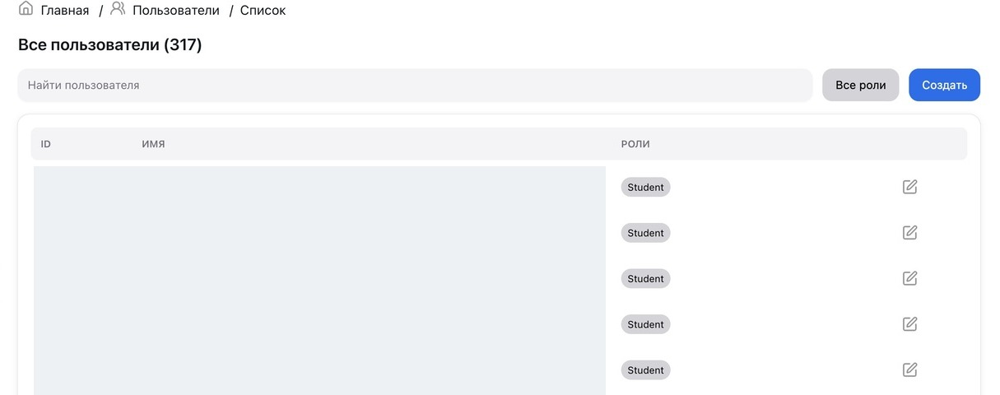

# Пользователи, роли и профиль

## Список пользователей

Откройте **Главное меню → Пользователи**. В таблице показаны внутренний **ID**, имя и почта под ним, назначенные роли и
кнопка редактирования. Поиск принимает имя, адрес почты или ID. Если у двух людей одинаковые имена, сравните почту и ID
перед изменением записи.

. Имена, почта и ID закрыты.

## Карточка учётной записи

| Поле                 | Что показывает или меняет                                                                                                          |
|----------------------|------------------------------------------------------------------------------------------------------------------------------------|
| ID                   | Идентификатор пользователя в CMS. По нему удобно сверять [попытки](attempts.md).                                                   |
| Имя, почта, группа   | Данные профиля. Почта отображается в списке и в карточках попыток.                                                                 |
| Роли                 | Набор ролей пользователя в CMS. Доступ к конкретному серверу дополнительно определяется [разрешёнными ролями сервера](servers.md). |
| LTI ID               | Внешний идентификатор, который CMS хранит для связи с LTI. Используйте его для диагностики входа из Moodle.                        |
| Деактивирован        | Признак деактивированной учётной записи. При проблемах со входом проверьте его вместе с ролями и состоянием интеграции.            |
| Создан в, обновлен в | Время создания и последнего обновления записи.                                                                                     |
| Связные попытки      | Переход к попыткам этого пользователя с уже установленным фильтром.                                                                |

Из списка можно создать запись или открыть существующую. После **«Сохранить»** перечитайте запись и проверьте, что
назначены нужные роли.

## Роли

Раздел **«Роли»** открывается со страницы пользователей. В списке есть ID и название, в форме — название и код. Код
используется в настройках доступа и интеграциях. Например, роли `admin` и `instructor` открывают административную часть
меню, а `student` предназначена для прохождения работ. Наличие названия в списке само по себе не добавляет новых
разрешений к страницам и API.

Если пользователю нужно дать доступ к одному объекту инфраструктуры, используйте назначение в
карточке [объекта на карте](services.md). Там права задаются для конкретного объекта.

## Профиль и вход

Меню под аватаром показывает, под какой учётной записью выполнен вход, и предлагает перейти в свою карточку, **«Сменить
пароль»**, **«Сменить язык»**, открыть **«Сервисы»** или **«Выйти»**. Форма смены локального пароля запрашивает текущий
пароль, новый пароль и его подтверждение. Пароль Moodle меняется в Moodle. Кнопка **«Свернуть»** управляет боковым меню.

Если административный пункт пропал после входа, проверьте учётную запись и её роли. Если не проходит именно вход из
курса, начните с раздела [«Идентификации»](integrations.md).
