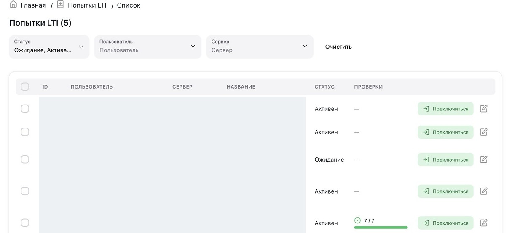

# Попытки LTI и оценки

Откройте **«Попытки LTI»** через счётчик **«Учебный контур»** на главной или через **«Связные попытки»** в карточке
пользователя. Попытка связывает пользователя, маршрут, сервер и результат конкретного запуска.

## Список и фильтры

| Колонка      | Что показывает                                                                                                           |
|--------------|--------------------------------------------------------------------------------------------------------------------------|
| ID           | Номер записи в CMS.                                                                                                      |
| Пользователь | Имя и почта, ссылка ведёт в карточку пользователя.                                                                       |
| Сервер       | Сервер, назначенный попытке, со ссылкой на его настройки.                                                                |
| Название     | Название маршрута и ссылка в его карточку.                                                                               |
| Статус       | Текущее состояние запуска или завершения.                                                                                |
| Проверки     | Баллы или число пройденных проверок, если результат сохранён. Тире означает, что в CMS пока нет результата для показа.   |
| Действие     | Для ожидающей или активной попытки доступна кнопка **«Подключиться»**. Кнопка редактирования открывает карточку попытки. |

Фильтр **«Статус»** допускает несколько состояний. В полях **«Пользователь»** и **«Сервер»** выберите запись из
подсказок. Фильтры работают совместно. Кнопка **«Очистить»** снимает их и возвращает общий список.

. Данные
участников закрыты.

## Статусы

| Статус      | Что произошло                                                                |
|-------------|------------------------------------------------------------------------------|
| Ожидание    | CMS создала попытку и ждёт назначения сервера или подтверждения запуска.     |
| Активен     | Сервер подтвердил, что стенд работает.                                       |
| Завершается | CMS запросила завершение и ждёт очистки ресурсов.                            |
| Завершена   | Сервер подтвердил завершение. Запись с результатом можно проверить в списке. |

В карточке указаны комната, пользователь, маршрут, сервер, текущий и максимальный балл, комментарий, время отправки и
даты записи. Изменение сервера или статуса в карточке меняет данные попытки. Для просмотра уже работающего стенда
используйте **«Подключиться»**.

## Рабочая область стенда K8S

| Элемент             | Что в нём смотреть                                                                                                                                                                             |
|---------------------|------------------------------------------------------------------------------------------------------------------------------------------------------------------------------------------------|
| Обзор               | Состояние стенда, готовность и рестарты узлов, этапы запуска. В параметрах среды есть namespace, версия задания и набор проверок. [Снимок обзора](../assets/screenshots/lab-5-0-overview.jpg). |
| Топология           | Узлы, соединения и имена интерфейсов. Нажмите узел, чтобы открыть доступные действия и терминал. [Снимок топологии](../assets/screenshots/lab-5-0-topology.jpg).                               |
| Задание             | JupyterLab с материалами работы. Рабочую область можно открыть в отдельной вкладке. [Снимок задания](../assets/screenshots/lab-5-0-notebook.jpg).                                              |
| Результаты проверок | Запуск checker, время последнего запуска, итоговый балл и подробности отдельных проверок.                                                                                                      |

Меню **«Управление стендом»** позволяет открыть обучение по интерфейсу. Если доступны действия с топологией, *
*«Перезапустить топологию»** перезапускает узлы и сохраняет записанные на них конфигурации, а **«Очистить топологию»**
возвращает узлы в исходное состояние. В верхней панели также можно обновить данные, переключить язык и тему или
остановить стенд. Перед остановкой сохраните файлы, которые нужно оставить после удаления рабочей среды.

## Когда оценка появится в Moodle

В панели стенда можно увидеть результат сразу после checker. В карточке попытки **«Отправлено в»** показывает время
успешной передачи оценки через LTI. Сравните эти два места, если студент видит балл в CMS, а в Moodle он пока
отсутствует.

Для оценки, полученной от Clabgate, CMS пробует отправку после приёма результата. При сбое ожидающую доставку повторяет
периодическая задача. Типовая конфигурация запускает её раз в пять минут. Если результат сохранился, а отметка долго
остаётся пустой, проверьте, что попытка началась через элемент Moodle и что у интеграции
настроены [сервисы оценок](integrations.md). Ручное редактирование балла в карточке не запускает автоматическую доставку
результата Clabgate.

## Завершение и удаление

Выделите нужные строки и нажмите **«Завершить выбранные»**, чтобы запросить остановку стендов с очисткой ресурсов.
Убедитесь, что участники сохранили отчёты, а в CMS виден актуальный результат. Действие **«Удалить»** удаляет записи
попыток. Для остановки работающего стенда используйте завершение, чтобы сервер получил запрос на очистку.
