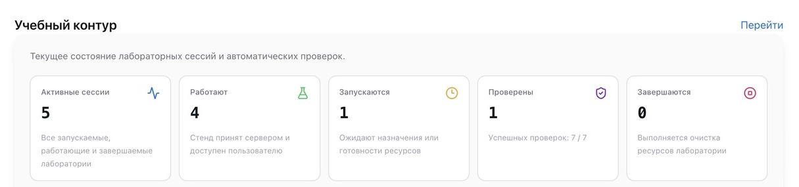

# Администрирование CMS Labs

Войдите в CMS Labs по адресу вашей инсталляции и откройте боковое меню. Административные пункты отображаются
для ролей администратора и преподавателя. Возможность просматривать и менять записи зависит от прав на конкретную
операцию.

## Где искать нужный раздел

| Раздел                                    | Для чего нужен                                                                                        |
|-------------------------------------------|-------------------------------------------------------------------------------------------------------|
| **Главная**                               | Оценить состояние учебного контура и перейти к проблемным попыткам.                                   |
| **Лабораторные работы**                   | Найти доступный стенд, запустить новую попытку или открыть текущую.                                   |
| [Попытки LTI](attempts.md)                | Найти работу пользователя по статусу и серверу, открыть стенд, проверить результат и отправку оценки. |
| [Маршруты LTI](routes.md)                 | Связать элемент курса с лабораторией, набором проверок и сервером.                                    |
| [Идентификации](integrations.md)          | Настроить доверие между CMS Labs и платформой курса, например Moodle.                                 |
| [Пользователи, роли и профиль](access.md) | Найти учётную запись, проверить её доступ, изменить пароль или язык интерфейса.                       |
| [Серверы](servers.md)                     | Настроить точки подключения и проверить распределение PNET.                                           |
| [Карта и сервисы](services.md)            | Посмотреть связи инфраструктуры, проверить доступ к объекту или настроить ссылку на внешний сервис.   |

## Главная

Блок **«Учебный контур»** показывает сводку и время её последнего обновления.

| Показатель      | Что означает                                                                                                                              |
|-----------------|-------------------------------------------------------------------------------------------------------------------------------------------|
| Активные сессии | Стенды в ожидании, в работе и в процессе завершения.                                                                                      |
| Работают        | Сервер подтвердил запуск стенда.                                                                                                          |
| Запускаются     | Попытка ждёт назначения сервера или готовности ресурсов. Чтобы понять причину задержки, откройте попытку и проверьте вкладку **«Обзор»**. |
| Проверены       | Активные попытки с сохранённым результатом checker. Показатель не отражает отправку оценки в Moodle.                                      |
| Завершаются     | Запрошено завершение, от сервера ожидается подтверждение очистки.                                                                         |

В таблице **«Активные сессии»** видны пользователь, сервер, название маршрута, статус и результат проверки. Клик по
счётчику открывает связанный список в [«Попытках LTI»](attempts.md). Счётчик **«Проверены»** открывает активные сессии.
Наличие результата проверяйте в колонке **«Проверки»**.

.

Ниже находятся ещё три блока.

| Блок                   | Что в нём смотреть                                                                                                                                             |
|------------------------|----------------------------------------------------------------------------------------------------------------------------------------------------------------|
| Статистика серверов    | Сравнение по доле распределения или последнему числу лабораторных. Можно переключить выборку между активными и всеми серверами и отсортировать записи по дате. |
| PNET распределение     | Очередь автоматического назначения серверов. Последняя использованная позиция отмечена ромбом.                                                                 |
| Последние пользователи | Быстрый переход к недавно добавленным записям. Для поиска по имени или почте откройте полный [список пользователей](access.md).                                |

## Лабораторные работы

Карточка показывает название, описание и, для совместных работ, число участников. **«Запустить»** создаёт попытку для
выбранной работы, **«Подключиться»** открывает уже запущенную. Поиск помогает найти карточку по названию или описанию.

Пункт появляется, когда каталог включён через `LAB_CATALOG_ENABLED` и CMS может вернуть хотя бы одну работу. Данные
карточек берутся из записей маршрутов. Если преподаватель запускает задания из Moodle, исходный вход через элемент курса
сохраняет LTI-контекст, который нужен для маршрутизации и передачи оценок.

## Где меняются настройки

Каждый раздел хранит настройки своей сущности. Параметры Moodle находятся в **«Идентификациях»**, выбор лаборатории и
сервера — в **«Маршрутах LTI»**, endpoints и доступ к серверу — в **«Серверах»**. Личные настройки доступны из меню *
*«Профиль»**. Настройки развёртывания CMS, ingress, хранилища и расписаний задач описаны в
разделе [«Kubernetes-кластер»](../usage/kubernetes.md).
