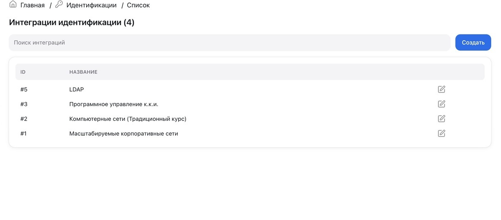

# Идентификации и Moodle

Раздел **Главное меню → Идентификации** содержит регистрации внешних систем входа. Список показывает ID, название и
действие **«Редактировать»**. Для запуска работы из Moodle нужна регистрация типа **LTI**. В форме также есть тип **LDAP
** с базовым URL и DN.

.

## Поля регистрации LTI

| Поле                               | Зачем оно нужно                                                                                                          |
|------------------------------------|--------------------------------------------------------------------------------------------------------------------------|
| Название                           | Имя интеграции внутри CMS.                                                                                               |
| Базовый URL                        | Адрес Moodle, с которым зарегистрирован инструмент.                                                                      |
| URL авторизации LTI                | Адрес Moodle для потока входа LTI.                                                                                       |
| URL токен LTI                      | Адрес Moodle, через который CMS получает токен для вызова сервисов, включая передачу оценок.                             |
| URL для получения сертификатов LTI | Адрес набора публичных ключей Moodle для проверки подписи запуска.                                                       |
| Ссылка CMS для входа через LTI     | Адрес обработчика запуска на стороне CMS. Для этой интеграции используется endpoint `/api/v2/lti/launch`.                |
| ID клиента LTI, ID deployment LTI  | Идентификаторы из регистрации инструмента в Moodle. Они позволяют сопоставить конкретную регистрацию и её развёртывание. |
| SSO LTI URL                        | Ссылка на элемент курса, через который пользователь может войти из CMS в поток Moodle.                                   |

В форме **«Настройка URL → Moodle»** подставляет стандартные адреса `/mod/lti/auth.php`, `/mod/lti/token.php` и
`/mod/lti/certs.php` по базовому адресу. Сверьте их с данными регистрации в Moodle.

## Что настроить в Moodle

1. Откройте в CMS раздел формы **«Параметры для Moodle»** и используйте значения этой инсталляции. В ней есть URL
   инструмента, версия LTI 1.3, публичный ключ, URL инициирования входа и URI перенаправления.
2. Если курс принимает автоматические оценки, включите **Assignment and Grade Services** и приём оценок от инструмента.
   Поля имени, почты и доступ к списку участников настройте согласно правилам курса.
3. Перенесите ID клиента и deployment из Moodle в регистрацию CMS. Откройте внешний элемент курса и проверьте вход
   тестовым пользователем.
4. Для каждого задания настройте соответствующий [маршрут LTI](routes.md). Если вход проходит, но открывается другое
   задание, проверьте параметры маршрута.

Если оценки не появляются, сначала проверьте [попытку](attempts.md) и отметку **«Отправлено в»**. Затем сверяйте
разрешения AGS, URL токена и регистрацию
Moodle. [Спецификация LTI 1.3](https://www.imsglobal.org/spec/lti/v1p3/) · [Спецификация Assignment and Grade Services](https://www.imsglobal.org/spec/lti-ags/v2p0/)
