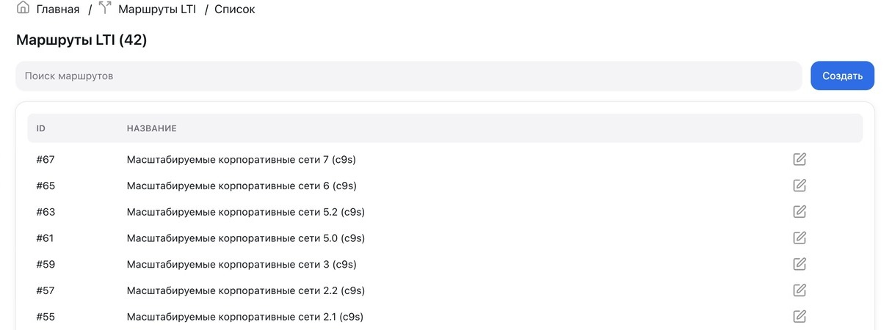

# Маршруты LTI

Маршрут определяет, какую лабораторную открыть при запуске элемента курса. Откройте **Главное меню → Маршруты LTI**. В
списке отображаются ID, название и редактирование. Поиск принимает ID, название, данные элемента курса и пути
лаборатории или проверок.

.

## Как выбирается маршрут

При входе из Moodle CMS получает название и описание элемента курса и пользовательские параметры LTI. Маршрут подходит,
если совпало одно из заполненных условий: название, описание или пара `ключ=значение` из параметров запуска. При
нескольких совпадениях учитывается дата создания маршрута, поэтому для разных курсов и вариантов лучше использовать
уникальные пары и исключить совпадающие названия и описания.

**«Маршрут по умолчанию»** — резерв на случай, когда по переданным параметрам не нашлось совпадения. Для учебных заданий
обычно нужен явный ключ. Например, для двух вариантов одной работы используйте `lab_key=net-autumn-05` и
`lab_key=net-traditional-05` в соответствующих элементах курса и маршрутах. Это примеры значений.

## Поля формы

| Настройка                                        | Что задаёт                                                                                                                                                                                              |
|--------------------------------------------------|---------------------------------------------------------------------------------------------------------------------------------------------------------------------------------------------------------|
| Название                                         | Имя маршрута внутри CMS. Его видно в списке, каталоге и попытках.                                                                                                                                       |
| Название элемента курса, описание элемента курса | Условия сопоставления с данными запуска LTI. Заполняйте их, если маршрутизация действительно должна зависеть от этого текста.                                                                           |
| Query LTI для элемента курса                     | Одна пара `ключ=значение` из пользовательских параметров LTI.                                                                                                                                           |
| Кол-во человек для совместной работы             | При значении больше одного работа использует комнату. Переход к стенду ждёт, пока соберётся указанное число участников.                                                                                 |
| Тип подключения                                  | Варианты **«Прямое»** и **SSO** передаются интеграции PNETLab и определяют режим входа. Для K8S CMS открывает рабочую область сессии.                                                                   |
| Подключение к лабораторной работе                | Для K8S — Git URL репозитория задания. При необходимости можно указать ref после `#`, например `https://git.example.org/net/lab-05.git#main`. Для PNET — путь, который понимает соответствующий сервер. |
| Запуск тестов лабораторной работы                | Путь или ключ проверок. Для K8S Clabgate передаёт его checker как `TEST_PATH`. Значение должно соответствовать набору проверок этой работы.                                                             |
| Автоматическое подключение к серверу             | Явный сервер для этого маршрута или **«Автоматически»** для пула PNET. Для K8S выбирайте нужный сервер явно.                                                                                            |

В пустой форме можно посмотреть [параметры сопоставления](../assets/screenshots/admin-lti-match.jpg)
и [действие при подключении](../assets/screenshots/admin-lti-action.jpg).

## Подключение нового элемента Moodle

1. Проверьте, что [интеграция Moodle](integrations.md) зарегистрирована, а нужный [сервер](servers.md) доступен.
2. В элементе курса задайте уникальный пользовательский параметр LTI. Скопируйте его в **«Query LTI для элемента курса»
   **.
3. Укажите лабораторную, набор проверок и сервер. Сохраните маршрут.
4. Откройте элемент из Moodle под тестовой учётной записью. В [«Попытках LTI»](attempts.md) сверьте название маршрута,
   назначенный сервер и статус. В стенде проверьте, что загружаются ожидаемое задание и проверки.

Чтобы исправить неверный запуск, ищите в первую очередь совпадающие ключи, названия и описания. Ранее закреплённый
сервер сохраняется у существующей попытки. Для проверки изменённого назначения используйте новую тестовую попытку.
