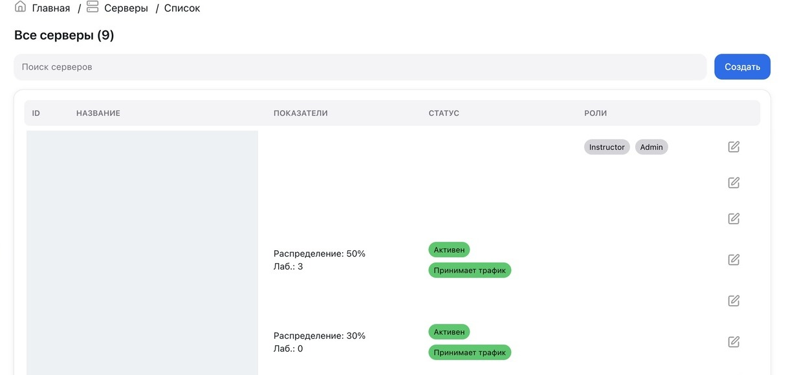

# Серверы

Раздел **Главное меню → Серверы** хранит точки подключения, которые CMS использует при переходе к лабораторному стенду
или при SSO. Запись сервера может указывать на Clabgate, обслуживающий кластер, а не на отдельный Kubernetes-узел.

## Что видно в списке

| Колонка    | Содержимое                                                                                      |
|------------|-------------------------------------------------------------------------------------------------|
| ID         | Внутренний идентификатор сервера.                                                               |
| Название   | Имя записи и URL подключения под ним.                                                           |
| Показатели | Для PNET отображаются процент распределения и последнее число запущенных лабораторных.          |
| Статус     | Для PNET отдельные индикаторы показывают, включён ли сервер и свежи ли данные о его активности. |
| Роли       | Роли, которым разрешён вход на этот сервер.                                                     |
| Действие   | Переход в карточку сервера.                                                                     |

Поиск принимает ID, название, URL и ClientID. Чтобы увидеть фактические работы на сервере, выберите его в
фильтре [«Попытки LTI»](attempts.md).

. Показатели и статусы видны, адреса закрыты.

## Карточка сервера

- **Название, URL, ClientID** определяют, как запись видна оператору и к какой точке подключения обращается CMS.
  ClientID используется как идентификатор интеграции при SSO. Он отличается от ID клиента в регистрации Moodle LTI.
- **Тип сервера** выбирается из **PNET**, **K8S** и **OpenID**. Для PNET CMS направляет пользователя в PNETLab, для K8S
  открывает стенд через Clabgate. OpenID предназначен для SSO-подключения.
- **Разрешенные роли** ограничивают, кто может авторизоваться через сервер. **Активный** управляет доступностью записи
  для механизмов, которые учитывают этот флаг, включая пул PNET.
- **Токен** используется для взаимодействия CMS с сервером. Храните его у оператора интеграции и исключайте из
  документации, переписки и снимков экрана.

### Распределение PNET

| Поле                                                | Как читать                                                                                                                                                             |
|-----------------------------------------------------|------------------------------------------------------------------------------------------------------------------------------------------------------------------------|
| Процент распределения                               | Доля сервера при автоматическом распределении. Для проверки текущего числа стендов используйте соседнее поле.                                                          |
| Минуты для автоотключения                           | Через сколько минут без обновления активности сервер исключается из автоматического распределения. Значение `0` отключает этот критерий.                               |
| Максимальное кол-во пользователей                   | Порог, при котором сервер исключается из пула. Сравнивается с последним переданным числом работающих лабораторных. Значение `0` убирает ограничение по этому критерию. |
| Последняя активность и последнее число лабораторных | Сведения, которые CMS получила от сервера. По времени активности можно понять, насколько свежа цифра нагрузки.                                                         |

Индикатор **«Принимает трафик»** отражает проверку времени последней активности. При распределении CMS также проверяет,
что сервер активен и его нагрузка ниже установленного порога.

## Как выбирается сервер для попытки

Сначала CMS использует сервер, уже закреплённый за попыткой. Для новой попытки действует сервер, заданный
в [маршруте](routes.md). Если маршрут оставлен в режиме **«Автоматически»**, используется общий пул PNET. Для
лабораторной на K8S укажите нужную запись Clabgate явно.

Перед выводом сервера из эксплуатации проверьте оба источника назначений: существующие попытки и маршруты, в которых
сервер выбран явно. Настройки автоматического пула относятся к выдаче новых назначений через этот пул.
