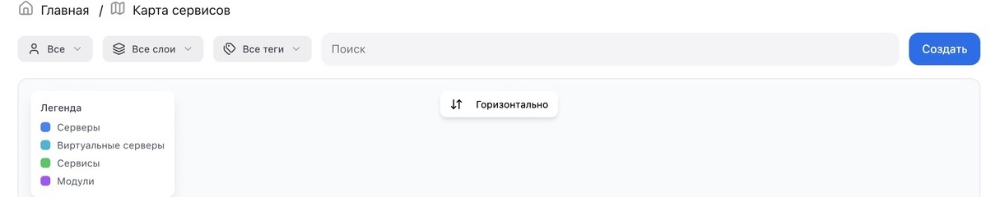

# Карта и сервисы

## Карта сервисов

Откройте **Главное меню → Карта**. Здесь отображаются связи объектов инфраструктуры: серверов, виртуальных серверов,
сервисов и модулей. Для поиска используйте название, фильтр **«Мои»**, слои **PROD**, **PRE**, **TEMP** и теги.
Топологию оборудования конкретной работы можно открыть во вкладке **«Топология»** её [сессии](attempts.md).

| Вкладка объекта | Что можно проверить                                                                                                                                                      |
|-----------------|--------------------------------------------------------------------------------------------------------------------------------------------------------------------------|
| Основное        | Название, описание, тип, теги и внешние ссылки. Здесь же видны родительские связи, по которым строится карта.                                                            |
| Пользователи    | У кого есть права на объект и какие роли назначены. Здесь можно добавить пользователя или изменить его права на этот объект.                                             |
| Дополнения      | Подключённые ресурсы и их параметры, например namespace или реестр, если это поддерживает дополнение. Доступные операции зависят от типа дополнения и прав пользователя. |

Для диагностики доступа откройте объект, проверьте его пользователей и нужную роль. Перед перевыпуском ключей выясните,
кто использует текущие учётные данные: после операции старые ключи могут перестать работать. Для некоторых дополнений
удаление требует отдельного подтверждения другим пользователем.

.

## Меню «Сервисы»

Меню открывается по логотипу **«СУиМ Лаб»** в верхней части боковой панели. Оно показывает ссылки на внешние сервисы.
Активная карточка с заполненным URL открывает сервис в новой вкладке.

Для редактирования откройте **Профиль → Сервисы**. Административный список также доступен по адресу `/service-cards` при
наличии прав. В списке видны ID, название, позиция, состояние и редактирование. В карточке задаются название, описание,
URL перехода, URL изображения, порядок и активность.

Если ссылка не отображается, проверьте, что карточка активна и URL заполнен. Если CMS предлагает повторить загрузку
сервисов, сначала обновите список через этот пункт. Доступ к самому внешнему приложению проверяет это приложение.

## Что выбрать

Чтобы предоставить ссылку на уже работающий сервис, создайте карточку. Чтобы описать место сервиса в инфраструктуре, его
связи и права пользователей, используйте карту. Для выбора сервера запуска лабораторной откройте [«Серверы»](servers.md)
или измените назначение в [маршруте LTI](routes.md).
