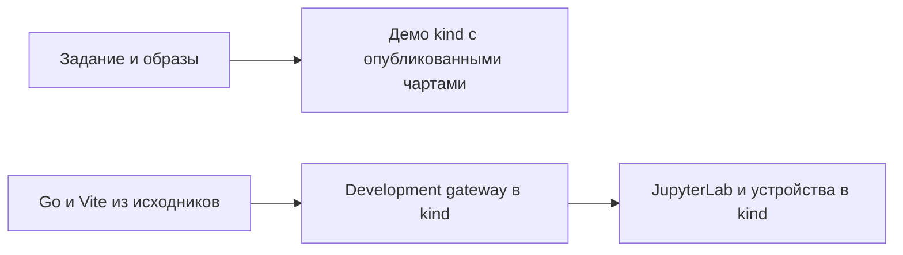

# Выбор среды разработки

| Что меняете | Как запустить | Где работают компоненты |
| --- | --- | --- |
| Notebook, манифесты задания, Helm values, checker, terminal или capture | [Полный стенд в kind](kind.md) | CMS Labs и сервисы запускаются в kind из опубликованных образов. |
| Backend или Clabgate на Go, frontend на Vite, nginx gateway | [CMS Labs из исходников](api.md) | MySQL и Vault запускаются в Docker, API и Vite — на компьютере, gateway и учебные сервисы — в kind. |

Для самой лабораторной используйте [контракт](../technical/lab-contract.md) и [руководство по подключению](../labs/authoring.md).
