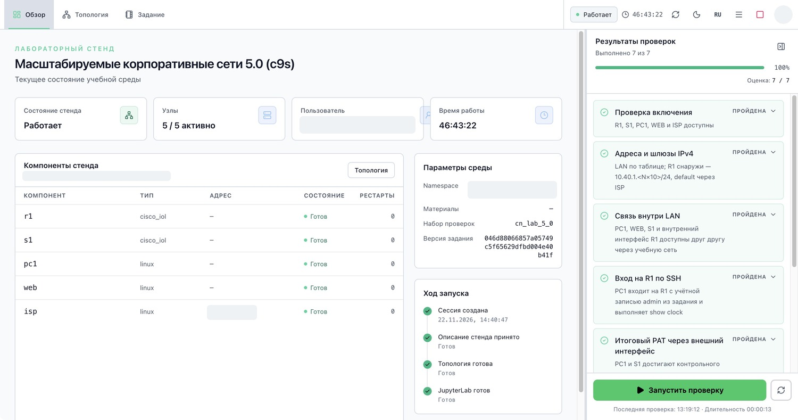
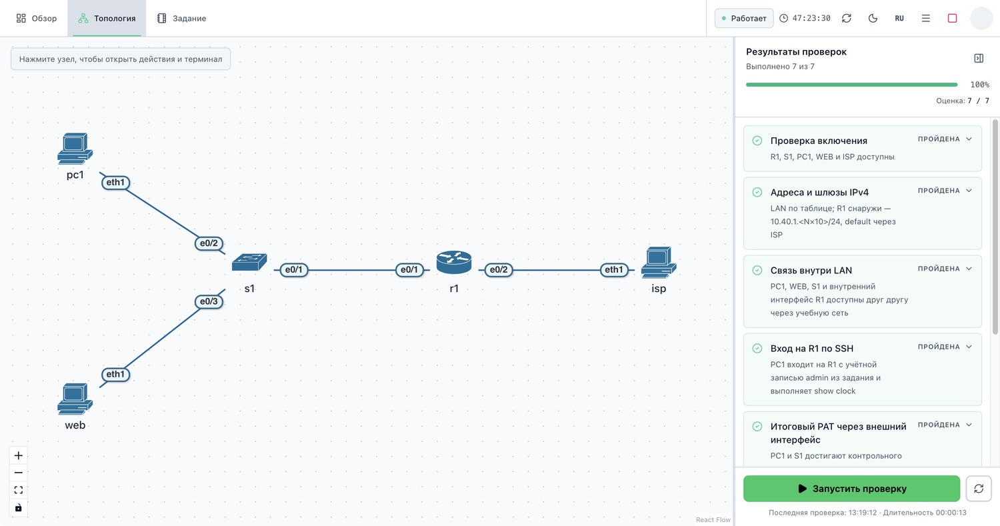
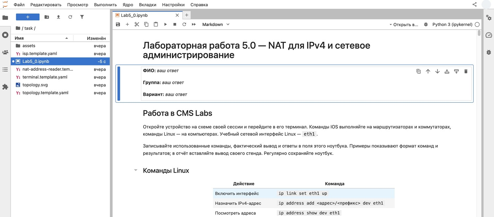

# CMS Labs

CMS Labs — платформа для воспроизводимых учебных лабораторных работ с сетевыми топологиями, терминалами, JupyterLab и
автоматической проверкой.

Эта документация предназначена для трёх групп читателей:

- студентам — как запустить работу и получить доступ к стенду;
- преподавателям и авторам курсов — как оформить задание и проверки;
- администраторам и разработчикам — как развернуть и сопровождать платформу.

## Использование готовой платформы

| Я хочу…                                       | Следующий раздел                                             |
|-----------------------------------------------|--------------------------------------------------------------|
| ничего не устанавливать локально              | [GitHub Codespaces](usage/codespaces.md)                     |
| запустить готовый полный контур на компьютере | [Локальный kind](usage/kind.md)                              |
| развернуть платформу для группы пользователей | [Kubernetes-кластер](usage/kubernetes.md)                    |
| посмотреть учебный сценарий                   | [Lab 1.0 УрФУ](labs/computer-networks/lab-001.md) |

Если работа назначена преподавателем, откройте её из курса или воспользуйтесь ссылкой, которую он выдал.

## Для автора лабораторной

[Подготовка и подключение работы](labs/authoring.md) ведёт от рабочего примера до запуска под тестовым пользователем.

## Для администратора

[Руководство по панели CMS Labs](admin/index.md) объясняет, как управлять пользователями, серверами, маршрутами LTI и
интеграцией Moodle, а также проверять запуски и оценки.

## Для разработчика

| Я меняю…                                                          | Следующий раздел                                   |
|-------------------------------------------------------------------|----------------------------------------------------|
| Helm-шаблоны, контракт задания или интеграцию готовых компонентов | [Полный стенд в kind](development/kind.md)         |
| backend, frontend или Clabgate из исходников                      | [Разработка cms-labs-api](development/api.md)      |
| понять устройство системы                                         | [Обзор архитектуры](technical/architecture.md)     |
| подготовить собственную лабораторную                              | [Контракт лабораторной](technical/lab-contract.md) |

## Что входит в платформу

- CMS и web-интерфейс для пользователей, курсов и попыток;
- Clabgate для управления сессиями и безопасного доступа к workspace;
- Clabernetes для запуска сетевой топологии в Kubernetes;
- JupyterLab, терминалы, checker и захват трафика как сервисы лаборатории;
- Git-репозиторий задания как версионируемый источник конфигурации и материалов.

## Во время лабораторной

??? info "Открыть стенд"
Перейдите в «Лабораторные работы» и откройте нужную попытку. Дождитесь статуса «Работает». На вкладке «Обзор» можно
проверить готовность стенда и открыть доступные сервисы.

??? info "Найти узел и выполнить задание"
Откройте вкладку «Топология» и найдите узлы и подписи их интерфейсов. Нажмите узел, чтобы увидеть доступные действия и
открыть терминал. Инструкции и notebook доступны на вкладке «Задание», если они предусмотрены в работе.

??? info "Разобрать результаты проверок"
Рядом с топологией есть панель «Результаты проверок». Нажмите «Запустить проверку» и дождитесь результата. Нажмите на
отдельную проверку, чтобы изучить её условие и детали. После исправления конфигурации запустите проверку снова.

??? info "Сохранить результаты"
Перед завершением попытки скачайте материалы, которые требует преподаватель: notebook, отчёт или файлы захвата. После
завершения сетевые узлы и сервисы попытки освобождаются.

### Скриншоты Lab 5.0

Все пять узлов готовы, в панели проверок видно «Выполнено 7 из 7».

Граф стенда с именами узлов и интерфейсов рядом с панелью checker.

Открытый notebook с полями для отчёта и справочной таблицей команд.
