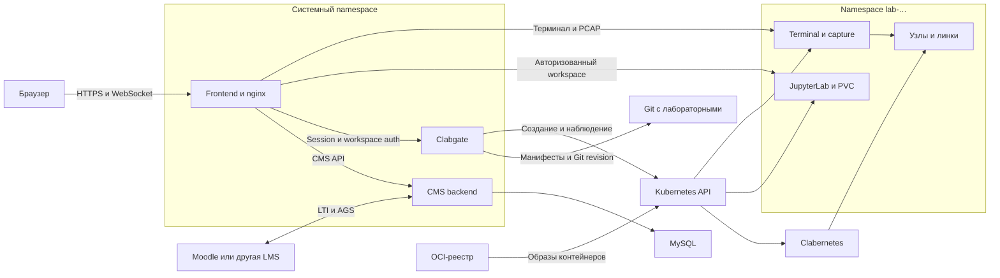

# Архитектура CMS Labs

CMS управляет пользователями, маршрутами, попытками и оценками. Clabgate управляет жизненным циклом Kubernetes-сессии. Quota, условия admission и версии компонентов задаются при развёртывании платформы.

- Каждая попытка получает свой namespace. Clabgate применяет рабочие манифесты и следит за готовностью JupyterLab и топологии.
- Checker запускается отдельным Job. Его namespace, ServiceAccount и образ задаёт оператор. Clabgate прикрепляет результат к попытке.
- Nginx принимает запросы браузера на одном origin. Доступ к JupyterLab, терминалу и capture проходит через проверку workspace-cookie.
- В production внешний вход направляется на frontend. Backend, Clabgate и workspace-сервисы могут оставаться внутри кластера.

[Взаимодействие компонентов](components.md) · [Жизненный цикл](session-lifecycle.md) · [Установка и настройки](../usage/kubernetes.md)
