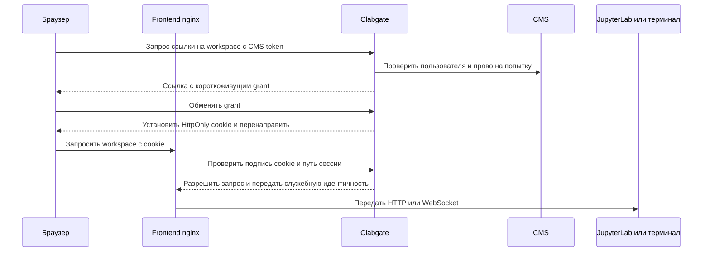

# Аутентификация и контроль доступа

CMS аутентифицирует пользователя через Moodle LTI, локальную учётную запись или LDAP, если он настроен. После входа frontend использует CMS token для обращения к API.

## Доступ к рабочей области

Grant действует до истечения TTL. Полученная cookie ограничена путём одной сессии. Nginx кэширует успешную авторизацию по паре cookie и идентификатор сессии; ошибки не кэшируются. Для production используйте HTTPS и `WORKSPACE_COOKIE_SECURE=true`. Реплики Clabgate должны использовать один `WORKSPACE_AUTH_SECRET` длиной не менее 32 байт. Смена ключа инвалидирует ранее выданные grant и cookie.

Для JupyterLab nginx передаёт проверенную идентичность по служебному заголовку. В стандартном deployment JupyterLab отключено автоматическое монтирование ServiceAccount token. Для checker Job используется ServiceAccount, настраиваемый оператором. Его доступ к Kubernetes ограничивайте требуемыми разрешениями.

Если grant истёк, заново откройте сервис из активной попытки. Для входа из Moodle используйте [«Идентификации и Moodle»](../admin/integrations.md). Для диагностики прокси и WebSocket откройте [«Диагностику»](troubleshooting.md).
