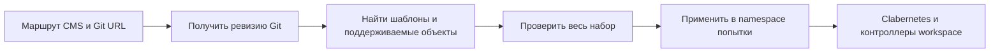

# Контракт лабораторной работы

Clabgate загружает рабочие манифесты из Git и применяет их в namespace попытки. Проверенный пример — [cms-labs-simple-task](https://github.com/cms-lab-core/cms-labs-simple-task/tree/main/task).

## Файлы рабочего примера

| Файл | Кто его использует |
| --- | --- |
| `task/topology.template.yaml` | Clabgate применяет `Topology`, а Clabernetes создаёт узлы и соединения. |
| `task/terminal.template.yaml` | ConfigMap `cms-labs-terminal-config` с меткой `cms-labs.io/terminal-config: "true"` задаёт цели и команды для контроллера terminal. |
| `task/capture.template.yaml` | ConfigMap `cms-labs-capture-config` с меткой `cms-labs.io/capture-config: "true"` задаёт лимиты для контроллера capture. |
| `task/task.ipynb` и дополнительные материалы | JupyterLab открывает файлы рабочей копии. |
| `task/lab.json` | Метаданные рабочего примера и локальных сценариев. Clabgate ищет Kubernetes-манифесты по суффиксу шаблона. |
| `demo-labs.json` | Список работ для импорта в каталог демо. В маршруте задаётся ключ проверки, который Clabgate передаёт checker через `TEST_PATH`. |

## Ревизия и манифесты



- Git URL может указывать ветку, тег или SHA после `#`. Для существующей попытки Clabgate хранит выбранную ревизию. Используйте новую попытку, чтобы проверить обновление ветки.
- Clabgate рекурсивно читает файлы `*.template.yaml` и `*.template.yml` в выбранном дереве. Он оставляет поддерживаемые документы из этих файлов. Для сессии требуется ровно одна `Topology` с `apiVersion: c9s.run/v1alpha1`.
- При применении `$NAME` заменяется на namespace попытки. Если шаблон использует `$WORKSPACE_PROXY_NAMESPACE`, в Clabgate нужно настроить эту переменную или `POD_NAMESPACE`. Ресурсы получают namespace и служебные метки сессии.
- Помимо `Topology` поддерживаются `ConfigMap`, `ServiceAccount`, `Service`, `Deployment`, `Role`, `RoleBinding` и `NetworkPolicy`. Для манифеста `Service` допустим тип `ClusterIP`. Публикацией портов самой топологии управляет отдельная настройка Clabernetes.

## Примеры проверки

Такой шаблон добавляет обычный ConfigMap рядом с шаблоном топологии.

```yaml
apiVersion: v1
kind: ConfigMap
metadata:
  name: lab-instructions
  namespace: $NAME
data:
  welcome: "Откройте задание в JupyterLab"
```

Clabgate отклонит следующий `Service`, потому что в манифесте указан тип `NodePort`.

```yaml
apiVersion: v1
kind: Service
metadata:
  name: lab-web
  namespace: $NAME
spec:
  type: NodePort
  selector:
    app: lab-web
  ports:
    - port: 80
```

У поддерживаемых Deployment также проверяются host namespaces, `hostPath`, фиксированный `nodeName`, `hostPort` и повышение привилегий. В `Role` запрещены wildcard-правила. `RoleBinding` может связывать только локальную `Role` с ServiceAccount того же namespace. Cluster-wide объекты, например `ClusterRoleBinding`, отфильтровываются на этапе загрузки.

Перед публикацией выполните проверку YAML и прогон в локальном кластере. `kubectl apply --dry-run=server` проверяет схему Kubernetes, а ограничения Clabgate проверяются при запуске тестовой попытки.

[Подключение лабораторной](../labs/authoring.md) · [Код фильтра и валидации](https://github.com/cms-lab-core/cms-labs-api/tree/v1.20.5/clabgate/app/queries)
