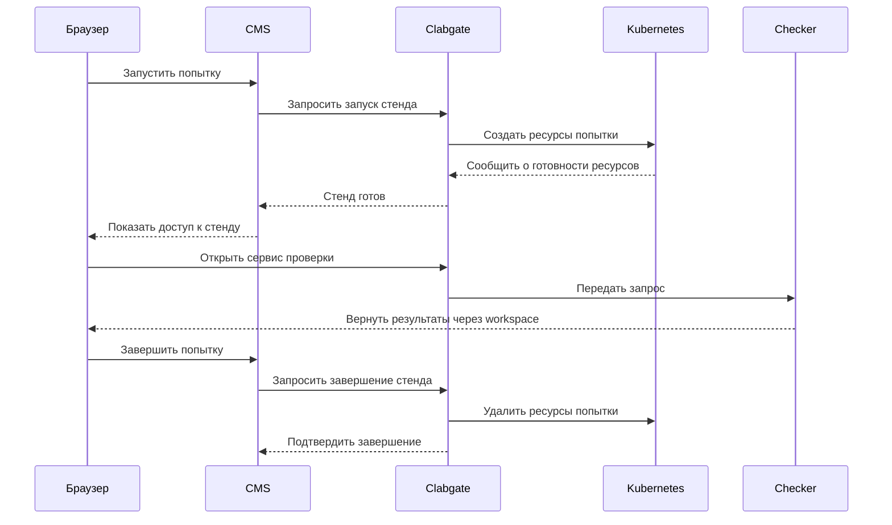

# Жизненный цикл лабораторной сессии

## Состояния

| В CMS | Что происходит со стендом K8S |
| --- | --- |
| `pending` | Попытка ждёт назначения или ресурсов. Clabgate создаёт namespace, проверяет манифесты и наблюдает состояние JupyterLab и топологии. |
| `active` | Сервер подтвердил рабочий стенд. Clabgate показывает фазу `ready`, когда готовы топология и рабочая область. |
| `terminating` | Запрошена остановка. Clabgate удаляет ресурсы попытки. |
| `completed` | Сервер подтвердил завершение. Результат, сохранённый в CMS, остаётся в карточке. |

В состоянии запуска Clabgate может сообщить `provisioning`, `degraded` или `failed`. Для диагностики используйте события namespace, статус топологии и лог соответствующего pod.

## Завершение

Перед необратимым завершением UI должен предупредить пользователя и напомнить:

- дождаться проверки преподавателя, если она обязательна;
- сохранить notebook (`.ipynb`) и экспорт (`.html`);
- скачать необходимые PCAP и другие артефакты;
- убедиться, что автоматические проверки завершены.

## Запуск, проверка и завершение

