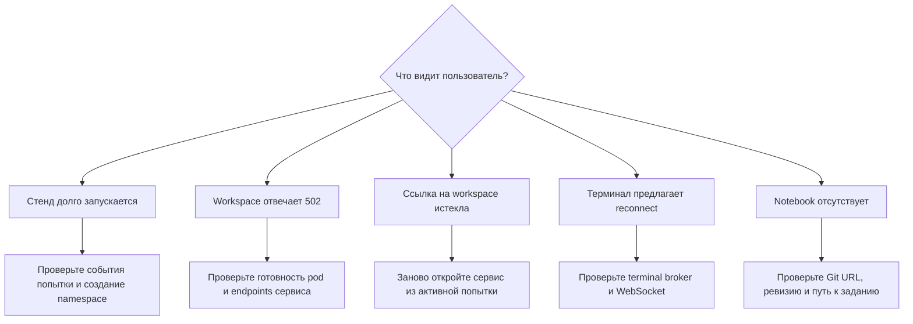

# Диагностика

## С чего начать

## Сессия не становится active

Проверьте по порядку:

1. событие попытки в CMS;
2. логи Clabgate;
3. создание namespace;
4. состояние topology и событий Clabernetes;
5. image pull и readiness Jupyter/checker/terminal;
6. лимиты ресурсов и admission policies.

## Workspace отвечает 502

- убедитесь, что pod сервиса готов и Kubernetes Service имеет endpoints;
- проверьте логи workspace proxy для этой попытки;
- если endpoints есть, проверьте маршрут ingress и порт сервиса.

## Workspace показывает invalid or expired grant

- проверьте время на узлах;
- откройте сервис заново, чтобы получить grant с актуальным TTL;
- проверьте cookie path для `/clabgate/workspace/<session>/...`;
- сравните TTL grant и кэш `auth_request`;
- проверьте, что все реплики Clabgate используют один ключ workspace.

## Терминал предлагает reconnect

- проверьте terminal broker и target-конфигурацию;
- убедитесь, что shell переживает отключение WebSocket;
- проверьте команду для типа узла (`bash`, `ash`, SR Linux CLI);
- проверьте workspace proxy и поддержку WebSocket ingress.

## JupyterLab не получает задание

- проверьте Git URL и revision;
- SHA коммита нельзя передавать как имя несуществующей ветки;
- проверьте путь notebook внутри workspace;
- изучите лог синхронизации до открытия `/lab/tree/...`.

## Checker не запускается

Откройте события checker Job в системном namespace. Сообщение `serviceaccount "cms-labs-checker" not found` указывает, что Job ссылается на отсутствующую учётную запись. Проверьте `CHECKER_NAMESPACE`, `CHECKER_SERVICE_ACCOUNT` и конфигурацию ролей в [установке Kubernetes](../usage/kubernetes.md). У опубликованного демо значения checker зависят от версии values.

Если pod запустился, но отчёта нет, проверьте его logs, соответствие `TEST_PATH` образу и время выполнения. Если Kubernetes сообщает `Forbidden`, проверьте права этой учётной записи на namespace учебной попытки.
